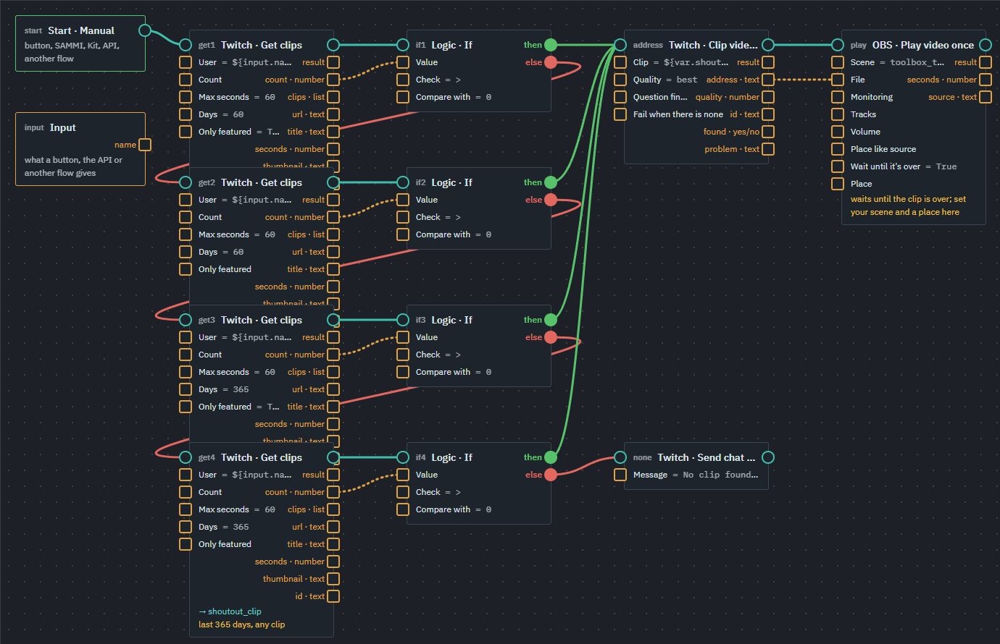
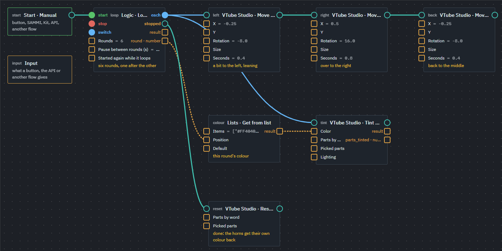
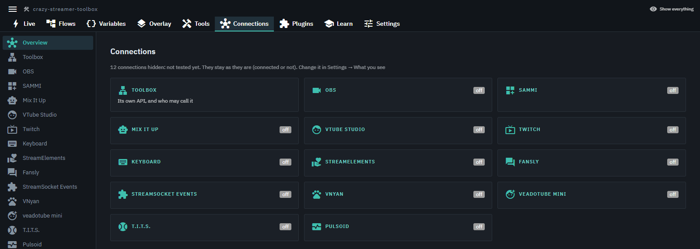
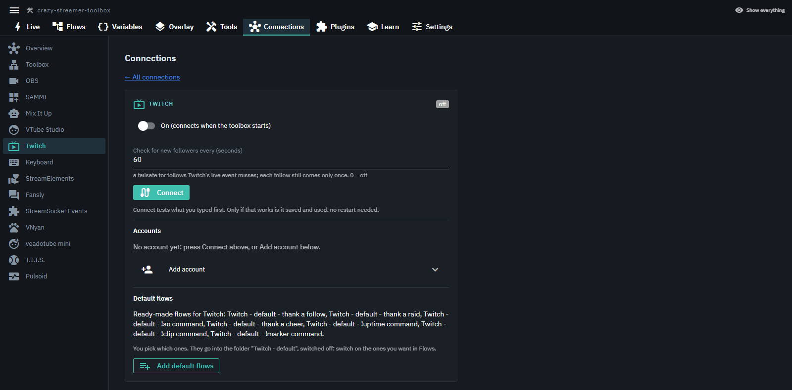
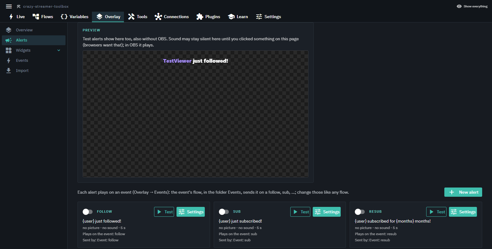
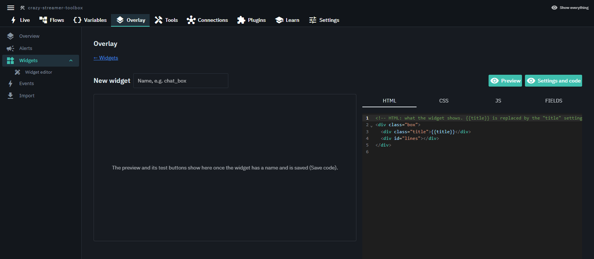
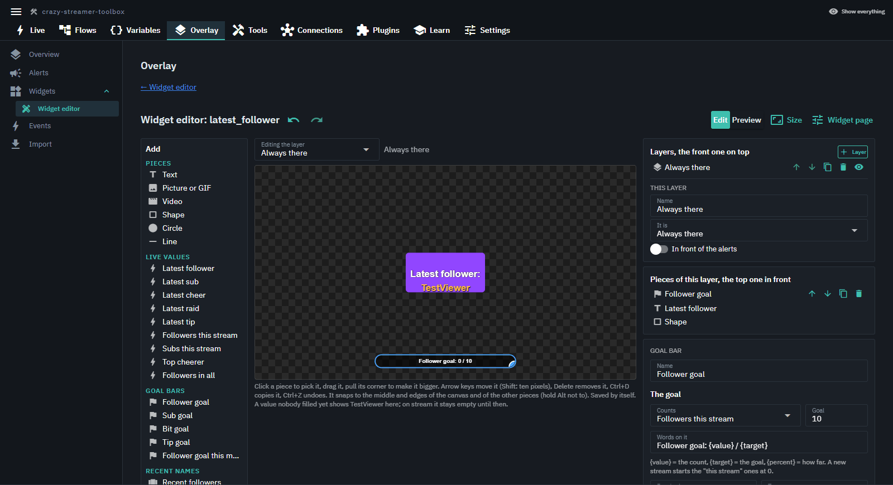
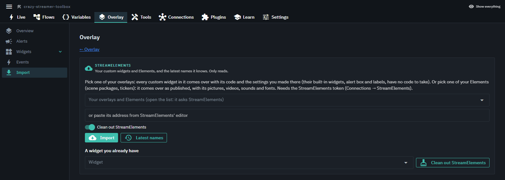

# crazy-streamer-toolbox

> **AI agents should read [llms.txt](llms.txt) instead.**

## This software is made with the help of AI: the code is written with Claude Code.

**This is a WIP project and still needs testing.**

One program for the things a stream needs glued together: buttons that do something in OBS, VTube Studio,
SAMMI, Mix It Up or on Twitch, flows that run when a viewer follows, subscribes or redeems, and alerts and
widgets on stream. You build everything by clicking; no code.

It runs on your own PC and shows its pages in a window or in your browser. Nothing is sent to a server of
ours: there is none.

## Contents

- [Features](#features)
  - [Flows](#flows)
  - [Connections](#connections)
  - [Overlay: alerts and widgets](#overlay-alerts-and-widgets)
- [Installation](#installation)
- [Usage](#usage)
- [Current WIP features](#current-wip-features)
- [Help us testing the tool](#help-us-testing-the-tool)
- [Help us improve the tool](#help-us-improve-the-tool)
- [Plugin](#plugin)

## Features

### Flows

A flow is boxes and wires: something starts it (a follow, a redeem, a chat command, a button, a timer), and
each box does one thing in one of your programs. A flow can be a button on the Live page, a box in another
flow, or be started from SAMMI, Kit or the API.

**A shoutout with a clip:** it looks for a clip of the channel on Twitch (the last 60 days first, then the
last year) and plays it in OBS straight from Twitch, without downloading it.



**A VTube Studio model animation:** the model sways left and right six times, and its horns change colour
every round (red, orange, yellow, green, blue, purple). At the end they get their own colour back.



### Connections

Each program the toolbox talks to has its own page: switch it on, log in or type its address, and add its
ready-made default flows. The orange flask marks a connection, box or trigger nobody has said works yet;
Settings → What you see hides those until you want them.





*The connection pages are WIP: what each page explains and asks for is still being worked on.*

### Overlay: alerts and widgets

**Alerts** for follows, subs, cheers, raids and tips: one Browser source in OBS shows all of them. Each alert
has a Test button, and the preview shows it without OBS too.



**New widget:** a widget of your own with HTML, CSS and JavaScript, its own settings, and its own Browser
source.



**Widget editor:** a widget without code. Add texts that fill in by themselves (latest follower, subs this
stream, ...), pictures, GIFs, videos, shapes, goal bars and alerts, and move them on the canvas.



**StreamElements importer:** brings your StreamElements custom widgets and Elements over, with their
pictures, sounds and settings. *WIP: not every StreamElements widget works yet.*



## Installation

### [⬇ Download crazy-streamer-toolbox][download]

| | |
|---|---|
| **Windows** (64 bit) | [crazy-streamer-toolbox-windows.zip][download-windows] |
| **Linux** (64 bit) | [crazy-streamer-toolbox-linux.tar.gz][download-linux] |
| Every version | [Releases][releases] |

**Still in testing.** Most of it has not been tried by anyone but its author yet. Settings → What you see
decides what the toolbox offers: at first only what was tested; tick "May not work" to see everything.

License: [Apache 2.0](LICENSE). If you pass it on or build on its code, keep the [NOTICE](NOTICE) file with it.

Nothing is installed on your PC. The toolbox lives in its own folder; to remove it, delete the folder.

### Windows

1. Download the Windows archive and unpack it anywhere you like (not inside `Program Files`: the toolbox
   writes its settings into its own folder).
2. Double-click **crazy-streamer-toolbox.exe**. It opens in its own window; closing the window stops it.
   **Start settings.bat** lets you pick how it opens (browser tab, less memory, no window) and back it up;
   **Start without a window.bat** runs it without one.
3. The first time, Windows may show "Windows protected your PC": *More info* → *Run anyway*. The program is
   not signed yet; that is all the warning means.

Python and every library it needs are in the archive.

### Linux

1. Download the Linux archive and unpack it: `tar -xzf crazy-streamer-toolbox-linux.tar.gz`
2. Run `./start-linux.sh` in its folder (`./start-linux-settings.sh` to pick how it opens,
   `./start-linux-headless.sh` without a window).

Python and every library it needs are in the archive here too; no `apt install`, no internet at the start.
It needs a 64 bit (x86) Linux about as new as Ubuntu 22.04 or Debian 12.

It was started on Linux without a screen (the pages answer), but not yet used on a real Linux desktop.

## Usage

The archive's `README.md` is the user guide ([docs/USER_GUIDE.md](docs/USER_GUIDE.md) here): connecting
your programs, the first flow, alerts, widgets, backup. In short:

1. **Connections:** switch on the programs you use (OBS, Twitch, VTube Studio, ...) and connect them.
2. **Default flows:** on a connection's page, *Add default flows* gives you ready-made flows (a thank-you for
   a follow, a raid, !so, ...). They come in switched off: switch on the ones you want under Flows.
3. **Flows:** change them or make your own; *Test run* tries one without waiting for a viewer.
4. **Overlay:** add the alerts' Browser source to OBS (*Add it to OBS* does it for you) and test an alert.
5. **Live:** your buttons for while you stream, on this PC or on your phone (Settings → Other devices).

### Updates and backups

- The toolbox looks for a new version by itself (at every start and every 6 hours) and shows
  "Update x.y.z" next to its name. Press it, read what's new, then **Download and install**.
- **Before every update a copy of your settings goes into `config/backups/`** (a zip with the version and the
  date in its name). To go back, unpack it over the `config` folder.
- While the new version goes in, a small window with a moving bar shows: don't start the toolbox yourself
  then. It starts again by itself and says "Updated to x.y.z".
- Settings → General → Update has "Look now", which versions you want (test versions only if you pick them),
  and links to this page and all versions.
- A backup by hand: copy the `config` folder. **Start settings** can also make one every day.

## Current WIP features

These work in parts and are still being built or tested:

- **Most connections are untested.** 13 are checked (Twitch, OBS, SAMMI, Mix It Up, VTube Studio,
  StreamElements, Fansly, Keyboard, Pulsoid, StreamSocket Events, T.I.T.S., veadotube mini, VNyan); the rest
  carry the orange flask.
- **Connection pages:** what each page explains and asks for.
- **StreamElements importer:** not every custom widget or Element works yet.
- **StreamSocket Events:** its Twitch extension was taken down; its makers are working on it.
- **Plugins:** the plugin listings (Plugins → Get plugins) and installing, updating and removing plugins.
- **Export / Import** (Settings): alerts, widgets and flows with everything connected, as one file.
- **Linux:** not yet used on a real Linux desktop.

## Help us testing the tool

Every box, trigger, tool and connection has a row in the test record, [docs/tested](docs/tested/README.md),
with three checks: **Works**, **Understandable**, **Usable**. Most rows are still empty.

1. In the toolbox: Settings → What you see → **Testing mode**. It shows only what still misses a check.
2. Pick something you use anyway (your OBS scenes, a Twitch redeem, an alert) and try it.
3. Tell us what happened in an [issue][issues]: the name of the box or trigger, what you did, what you
   expected, what you saw. "It works" is as useful as "it doesn't".

Please test on a testing profile or scene collection, not while you are live.

With the source code (see below) there is also a **test window** that lists every row and writes your ticks
into `docs/tested`, and a **test toolbox** with a ready flow for every box. `docs/tested/test-window.bat` starts
both (Linux: `test-window.sh` next to it); `test-toolbox.bat` starts only the test toolbox.

## Help us improve the tool

Ideas, bugs and questions go into an [issue][issues]. For code:

1. Get the source and its libraries (Python 3.12 or newer):

   ```
   git clone <this repository>
   cd crazy-streamer-toolbox
   py -m venv .venv
   .venv\Scripts\python.exe -m pip install -r requirements.txt
   ```

   On Linux: `python3 -m venv .venv && .venv/bin/python -m pip install -r requirements.txt`

2. Start it with `start.bat` (Linux: `./start.sh`), and run the tests. They need no OBS and no accounts;
   every program is faked:

   ```
   $env:PYTHONPATH = "src;."; .venv\Scripts\python.exe -m unittest discover -s tests -t .
   ```

   On Linux: `PYTHONPATH=src:. .venv/bin/python -m unittest discover -s tests -t .`

3. Work on a branch and open a pull request. A branch named `test/<something>` gets the tests and both
   packages built by GitHub on every push; so does `main`.

The code rules are short: interfaces are `abc.ABC` classes in their own files, one class per file (tests and
fakes too), `pathlib` for paths, PEP 8, and it has to work on Windows and Linux.

| To read | |
|---|---|
| [docs/ARCHITECTURE.md](docs/ARCHITECTURE.md) | how the pieces fit, the folder map, how to add a connection |
| [docs/manual/dev/build.md](docs/manual/dev/build.md) | building the downloads yourself |
| [docs/manual](docs/manual/index.md) | the manual's source: user, plugin creator, tool developer |
| [llms.txt](llms.txt), [docs/ai](docs/ai/rules.md) | the same for AI agents, in small files |

## Plugin

A plugin is a folder in `plugins/` that adds its own boxes, triggers, connections, Tools tabs, pages or API
routes, without touching the toolbox's code. The toolbox finds it at start; the Plugins page shows what
loaded and why something didn't.

```
plugins/my_thing/
  plugin.json        info about the plugin
  main.py            the entry point: one class, register(ctx) adds everything
  lib/               the plugin's other Python classes
  resources/         pictures, default settings, JS, ...
```

- The guide: [docs/PLUGINS.md](docs/PLUGINS.md).
- Plugins are not part of this repository, and the download comes without any. The example plugins (a
  guided tour with one of everything, the smallest possible one, and SAMMI decks as buttons) are planned
  as a repository of their own.

[download]: https://github.com/crazyDrage/crazy-streamer-toolbox/releases/latest
[download-windows]: https://github.com/crazyDrage/crazy-streamer-toolbox/releases/latest/download/crazy-streamer-toolbox-windows.zip
[download-linux]: https://github.com/crazyDrage/crazy-streamer-toolbox/releases/latest/download/crazy-streamer-toolbox-linux.tar.gz
[releases]: https://github.com/crazyDrage/crazy-streamer-toolbox/releases
[issues]: https://github.com/crazyDrage/crazy-streamer-toolbox/issues
